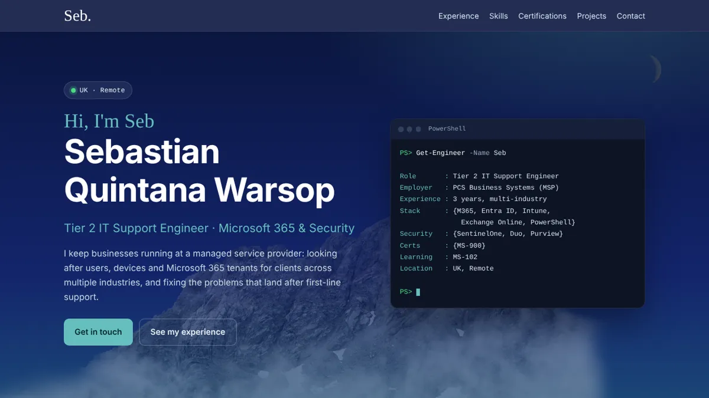

# webdevjourney

My personal site and CV: Sebastian Quintana Warsop, Tier 2 IT Support Engineer.

## What's here

- `index.html`: the main page (about, experience, skills, qualifications, projects, contact)
- `project.html`: a write-up of **FOV CRM**, a C# Windows Forms client management app I built during my IT apprenticeship
- `CSS/styles.css`: all styling
- `js/slideshow.js`: the project image slideshow
- `images/`: WebP images used by the site

## Running it

It's plain HTML, CSS and JavaScript with no build step. Open `index.html` in a browser.
